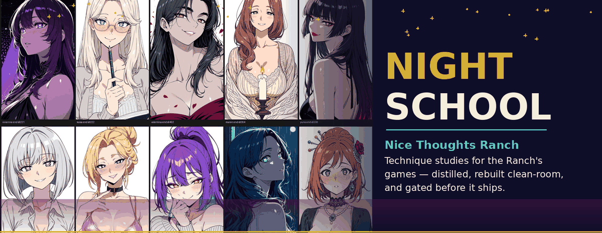

  

  
  
  
  

# Night School

**Class is in session after dark.** Night School is the Nice Thoughts
Ranch study programme for externally published adult-animation and
adult-art tutorials: every video is run through a five-pass protocol —
intake, timed observation, distillation, clean-room rebuild, and a
gated application — until what it teaches exists in our own toolchain
as named, tested capability.

The subject matter is NSFW. The method is not casual: nothing studied
here is copied into shipped work. Mechanisms are extracted, rebuilt
from the written technique sheet alone, and gated before they touch a
game. Where a technique is lane-neutral (camera craft, render passes,
clothing fit, scene construction), the plan names its SFW translation
explicitly — most craft is.

> **18+.** This repository documents study plans for adult material.
> It contains no adult imagery and no source media — and never will:
> see the standing rules in the protocol.

## The method

One protocol governs every plan — [`protocol/STUDY-PROTOCOL.md`](protocol/STUDY-PROTOCOL.md):

1. **Intake** — the source recorded, the expectation written *before* viewing, the licence posture noted.
2. **Timed observation** — a timestamp log of settings, stacks, and decisions; surprises and on-screen fixes are the real curriculum.
3. **Distillation** — the log rewritten as technique sheets: mechanism, invariants, failure modes — each marked **Adopt**, **Adapt**, or **Reject** (with the reason).
4. **Clean-room rebuild** — rebuilt from the sheet alone, in our own tools, deterministic and recorded; the video's own claims become the test list.
5. **Application and gate** — applied to a named production target and judged expected-vs-seen. Numbers support the verdict; they never carry it alone.

New plans start from [`plans/TEMPLATE.md`](plans/TEMPLATE.md). Finished
study runs land in [`results/`](results/) — a plan without a results
directory has not been run yet.

## The cast

The header is the studio's cast end-sheet — the women of the games
this programme serves, in their end-state register. Night School
exists so that what they do on screen keeps getting better: more
believable contact, better light, scenes that stay alive for their
full duration. Every plan names the production target it feeds —
a two-body scene, a keeper still, a stage, a fluid system — so study
never floats free of the work.

## Curriculum

Full table with execution order: [`CURRICULUM.md`](CURRICULUM.md).

**Founding set** (named by the studio, in study order):

| Plan | Study | Feeds |
|------|-------|-------|
| [07](plans/07-cum-sims-part-1-houdini-flip-to-blender.md) | Cum Simulation Pt 1 — Houdini FLIP (+Vellum) to Blender · Mushen | Fluid foundation |
| [06](plans/06-cum-sims-part-2-adding-to-animations.md) | Cum Sims Pt 2 — Adding to Animations · Mushen | Effect integration + retime test |
| [01](plans/01-animate-sex-in-blender-basics.md) | How to Animate Sex in Blender: Basics · Anime Nyan | Two-body contact animation |
| [02](plans/02-create-nsfw-images-in-blender.md) | Creating NSFW Images in Blender · RamFutaNSFW | Posed still pipeline |
| [05](plans/05-stable-diffusion-nsfw-art-harry-heck.md) | Stable Diffusion NSFW Art · Harry Heck | Generation workflow A/B |
| [04](plans/04-mugen-factory-stage-creation.md) | MUGEN Factory — Creation of a Stage | Layered scene construction |
| [03](plans/03-testing-patterns.md) | Testing Patterns (Virt-A-Mate) · TdotONY | Performance reference |

**Category intake** (the rest of the shelf, triaged honestly — a
content clip is labelled a content clip, and two entries are gated or
barred at intake on depicted-age grounds):

| Plan | Study | Feeds |
|------|-------|-------|
| [08](plans/08-eviction-devlog-1.md) | Eviction — DevLog #1 | Development process |
| [09](plans/09-semen-in-blender.md) | How to Make Semen in Blender | Blender-native fluid route (A/B vs 07) |
| [10](plans/10-animation-bootcamp-1.md) | Animation Bootcamp — 1 | Animation fundamentals |
| [11](plans/11-porn-in-blender-light-aovs.md) | Light AOVs | Relighting from passes |
| [12](plans/12-waifufactory-devlog-1.md) | WaifuFactory — Character Design DevLog | Character factory intake |
| [13](plans/13-porn-in-blender-beauty-pass.md) | Recreating Beauty Pass | Compositing discipline |
| [14](plans/14-futa-tutor-black-date.md) | Futa Tutor & Futa Black Date | Triage: content vs tutorial |
| [15](plans/15-bonnie-pov-tutorial.md) | Bonnie — POV Tutorial | Embodied camera craft |
| [16](plans/16-porn-in-blender-part-1.md) | How to Make Porn in Blender Pt 1 | Workflow triangulation |
| [17](plans/17-porn-in-blender-part-2.md) | How to Make Porn in Blender Pt 2 | Finishing triangulation |
| [18](plans/18-bonnie-ending.md) | Bonnie — Ending | Ending/apex beat grammar |
| [19](plans/19-bonnie-tutorial-part-2.md) | Bonnie Tutorial Pt 2 | Long-duration variation |
| [20](plans/20-bonnie-tutorial.md) | Bonnie Tutorial | Two-body method (vs 01) |
| [21](plans/21-miraculous-reunion.md) | Miraculous: Reunion | **Barred at intake** — canon-minor cast |
| [22](plans/22-shrinkwrap-sleeve.md) | Shrinkwrap Sleeve | Clothing fit preset |
| [23](plans/23-geonode-pillows.md) | Geonode for Pillows | Procedural soft props |
| [24](plans/24-tentacle-monster-wip-3.md) | Tentacle Monster WIP 3 | Appendage control grammar |
| [25](plans/25-cat-vid.md) | Cat Vid | Triage |
| [26](plans/26-toriel-roblok.md) | Toriel Roblok | Intake-gated (Roblox format) |
| [27](plans/27-unedited-roblok.md) | Unedited Roblok | Intake-gated; raw-take process |
| [28](plans/28-headhack-models.md) | How to Headhack Models | Audit of our headhack practice |
| [29](plans/29-amour-tv.md) | Amour TV | Triage |
| [30](plans/30-wl-scene-import.md) | WL Scene Import | Import contract micro-study |

**Category intake — page 2** (completing the shelf: 41 videos total):

| Plan | Study | Feeds |
|------|-------|-------|
| [31](plans/31-momo-toga-nomu.md) | Momo and Toga Tutorial | **Barred at intake** — canon-minor cast |
| [32](plans/32-dictator-daz-horse.md) | Dictator for Daz Horse 2 | **Barred at intake** — animal sexual content |
| [33](plans/33-cockorama-daz-dog.md) | Cockorama for Daz Dog 8 | **Barred at intake** — animal sexual content |
| [34](plans/34-witch-poses-timelapse.md) | Witch Poses Timelapse | Posing order grammar |
| [35](plans/35-how-not-to-make-renders.md) | How NOT to Make Renders | Failure taxonomy for gates |
| [36](plans/36-dildo-drone-daz.md) | Dildo Drone Asset (DAZ) | Prop registration mechanics |
| [37](plans/37-how-to-draw-sexy.md) | How to Draw Sexy (0:18) | Micro-claim, tested |
| [38](plans/38-nude-models-wrap3d.md) | Nude Models through Wrap3D | Conversion/wrapping flagship |
| [39](plans/39-breast-collision-jiggle-cage-deforms.md) | Jiggle Physics via Cage Deforms | Deterministic secondary motion |
| [40](plans/40-porn-in-blender-lighting-color.md) | Basics — Lighting & Color Grading | Light + grade template |
| [41](plans/41-porn-in-blender-images.md) | Basics — Images | Still composition grammar |

## House style — Daddy Style

The plans produce candidate techniques. **[Daddy Style](guides/)** is
the house style those techniques are rebuilt under: safety-first,
contract-first engine guides for Blender, Godot, Unity, Unreal, and
Aseprite, written for adult game production.

## Standing rules

- **Reference only.** No source media, frames, meshes, motion, or text
  from studied material enters shipped work — or this repo.
- **Mechanism over mimicry.** If a step cannot be explained, it is not
  distilled yet.
- **Lanes are explicit.** NSFW findings stay in NSFW surfaces; a
  technique crosses to SFW work only where its plan names the
  translation.
- **The bar is depicted age, not art style.** Anything not
  unambiguously adult is barred at intake, and the bar is recorded,
  not silent.

---

<i>Night School — a Nice Thoughts Ranch study programme. Est. 2026.</i>

